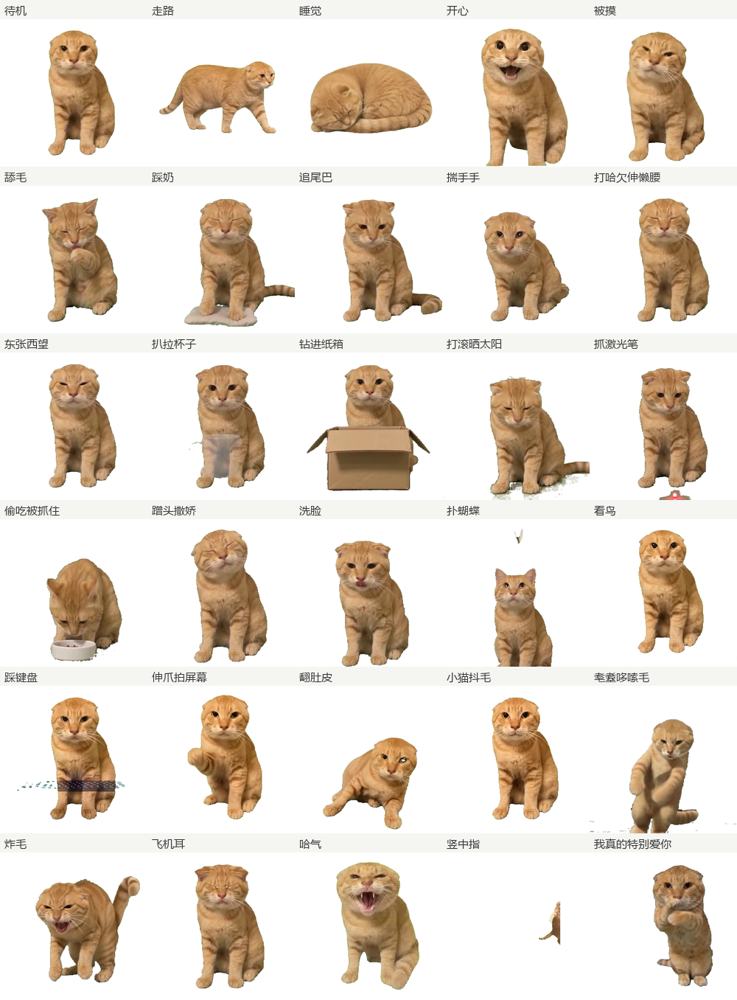

# 耄耋（maodie）· 橘猫桌宠 + DSH 插件清单

一只用 AI 视频生成的橘猫桌宠，跑在 [DeepSeek Harness](https://github.com/PC2005-cloud/dsh-pet) 的 `dsh-pet` 插件上：**32 个动作、带透明通道的 VP9-alpha webm、512×512 / 12fps**。

顺带附上一份我在用的 DSH 插件清单，以及把「绿幕视频 → 透明桌宠动画」的整条工具链。



## 里面有什么

| 路径 | 内容 |
| --- | --- |
| `pets/maodie/` | 桌宠素材包：`maodie-config.json` + 32 个动作 webm |
| `lib/index.js` | 插件宿主半侧：安装器本体（三方合并 + hash 校验 + 备份/回滚） |
| `lib/merge.mjs` / `lib/manifest.mjs` / `lib/pet-schema.mjs` | 配置三方合并、安装清单与文件判定、路径与动作名约定 |
| `tools/cli.mjs` | 安装器命令行：`--dry-run` / `--restore` / `--force` / `--prune` / `--rollback` |
| `tools/make-manifest.mjs` | 生成并校验 `.maodie-manifest.json` |
| `test/run.mjs` | 升级策略的回归测试（12 项）；`node tools/_runner.mjs test/run.mjs` 跑 |
| `package.json` / `cordis.patch.yml` | 插件清单：`dsh.bundle.patch` 指向挂载行 |
| `docs/preview.png` | 32 个动作的总览图（每格取该动作的第 0.6 秒） |
| `docs/maodie-prompts-cat.md` | 20 条猫动作的视频生成提示词（绿幕、10 秒、首尾同姿态） |
| `docs/橘猫后续动作提示词.docx` | 其中 08–20 共 13 条的 Word 版，方便直接发给生成工具 |
| `docs/竖中指参考视频拆解.md` | 「竖中指」梗图参考视频的逐秒拆解 + 绿幕改写版提示词 |
| `tools/maodie-matte.py` | 按色相抠图：把豆包/即梦的灰绿影棚背景抠成 alpha |
| `tools/maodie-check.py` | 体检：尺寸、fps、alpha 通道、绿边残留、循环接缝 |
| `tools/maodie-import.mjs` / `.cmd` | 批量转码 + 自动登记到 config |
| `tools/maodie-ref.png` | 白底参考图，用图生视频时当首帧参考 |
| `dsh-plugins-share.md` / `.json` | 我在用的 12 个 DSH 插件、装法、避坑 |

### 32 个动作

- **待机 / 移动**：待机（10 秒长循环；`animations.idle` 里实际挂了 23 条——基础待机 + 22 条小动作，空闲时轮播）、走路
- **点击回应**：开心、被摸、我真的特别爱你、笑
- **小动作（22）**：睡觉、开心、被摸、舔毛、踩奶、追尾巴、揣手手、打哈欠伸懒腰、东张西望、扒拉杯子、钻进纸箱、打滚晒太阳、抓激光笔、偷吃被抓住、蹭头撒娇、洗脸、扑蝴蝶、看鸟、踩键盘、伸爪拍屏幕、翻肚皮、小猫抖毛
- **生气（6）**：哈气、炸毛、飞机耳、耄耋哆嗦毛、竖中指、喷火

## 安装

### 方式一：当插件装（推荐）

本仓库同时是一个 DSH 插件（`package.json` 里声明了 `dsh.bundle`，`lib/index.js` 是宿主半侧）。装上它，素材会自动就位：

```bash
dsh plugin add https://github.com/Edwardpch/maodie-pet
```

或者在插件市场的「发现」页搜 `maodie`。插件加载时做且只做一件事：把 `pets/maodie` 里的 `maodie-config.json` 与 `maodie-animation/*.webm` 复制到 `%USERPROFILE%/.dsh/dsh-pet/pet/` 下（**平铺**，`pet/maodie-config.json` + `pet/maodie-animation/`）。

> 为什么强调平铺：dsh-pet 的 `scanPetFiles()` 只扫 `pet/` 的下一层，不递归子目录（`node_modules/dsh-pet/lib/index.js:859-870`）。0.2.x 曾装进 `pet/maodie/`，宿主根本不会加载；0.3.0 起改到扁平位置，升级时会自动把旧位置的素材 rename 过来，并把旧 config 当作你的当前配置继承。

前提仍然是先装 `dsh-pet` 本体（市场里搜 `dsh-pet`）。

### 右键菜单：固定 / 恢复走动

装上插件后，桌宠右键菜单的「更多 → maodie-pet」里会多一项：

- 橘猫在走动时显示「固定橘猫（待在原地）」，点一下就把 `pets/maodie-config.json` 里 `pets[0].fixedEnabled` 改成 `true`，宿主重载后它只做待机与分类动作，不再来回走；
- 已经固定时显示「恢复走动」，点一下改回 `false`。

这一项走的是 dsh-pet 自带的第三方菜单注册表（`/dsh-pet-7340/menu/item`），不改它的任何文件；菜单是进程内存态，DSH 重启后由插件重新注册。不想用这个菜单项，就直接改 `pet/maodie-config.json` 里的 `fixedEnabled` 再「重载配置」，效果一样。

注意改的必须是**生效的那份**：`~/.dsh/dsh-pet/pet/maodie-config.json`（扁平）。`pet/maodie/maodie-config.json` 是旧版位置，宿主不读。

### 升级：拉新动作不用手动拷文件

`pets/maodie/.maodie-manifest.json` 里记着每个素材的 sha256，安装器每次运行都做三方比较（**磁盘现状 / 包内新版本 / 上次安装时的基线**），再决定每个文件怎么办：

| 你的文件状态 | 新版包 | 结果 |
| --- | --- | --- |
| 和上次装的一样（没动过） | 变了 | 用新版覆盖，旧文件进备份目录 |
| 你改过 / 替换过 | 变了 | **保留你的**，不覆盖 |
| 你删掉了 | 包里还有 | **不复活**（想要就 `--restore`） |
| 你改过 | 新版删掉了 | 保留，不删 |
| 你没动过 | 新版删掉了 | 挪进备份目录（`--prune` 时才生效） |

`maodie-config.json` 同理：你加的动作、你的顺序、你改过的非动画字段（`size`、`display`、触发事件……）都保留，只把新版包里**新增**的动作追加进去；新分类按你的顺序插在后面。

```bash
# 查看这次会发生什么（不写盘）
node tools/cli.mjs --dry-run

# 升级 / 补齐（插件安装时自动跑的就是这个）
node tools/cli.mjs

# 补回你手动删掉的动作
node tools/cli.mjs --restore

# 连你改过的文件也强制按包覆盖
node tools/cli.mjs --force

# 清掉新版已移除的素材（挪进备份，不真删）
node tools/cli.mjs --prune

# 后悔了，还原上一次升级前的文件
node tools/cli.mjs --rollback
```

装成插件后也可以用 `node node_modules/maodie-pet/tools/cli.mjs ...`；自定义了 `DSH_HOME` 就加 `--home D:\somewhere\.dsh`。

每次真正写盘前，被覆盖/移除的文件都会先复制到 `$DSH_HOME/dsh-pet/pet/.maodie-pet-backup/<时间戳>/`，这就是 `--rollback` 的来源。

### 方式二：手动拷贝

1. 装 DeepSeek Harness 桌面端，并在插件市场里装 `dsh-pet`。
2. 把 `pets/maodie` 整个复制到：

   ```
   %USERPROFILE%/.dsh/dsh-pet/pet/
   ```

   也就是最终得到 `~/.dsh/dsh-pet/pet/maodie-config.json` 和 `~/.dsh/dsh-pet/pet/maodie-animation/*.webm`。注意是**平铺**在 `pet/` 下，不要放进 `pet/maodie/` 子目录——dsh-pet 只扫 `pet/` 下一层。
3. 刷新页面。默认是桌面宠物（`display: desktop`）；想在网页里显示，把 `maodie-config.json` 里的 `display` 改成 `web` 或 `both`。

只想换掉某几个动作？直接往 `maodie-animation/` 里加同名 webm，再在 `animations` 里登记即可——规则见下。

## 自己做动作

整条链路是：**提示词 → 图生视频（绿幕）→ 按色相抠图 → 体检 → 登记**。

```bash
# 1. 抠图：绿幕/灰绿影棚视频 → 512×512、12fps、VP9-alpha
python tools/maodie-matte.py 输入.mp4 输出.webm

# 可选参数
#   --ss 1.0 --to 6.0        截取片段
#   --fit                    保持整只猫入画，两侧用透明补齐
#   --erase 0,0,512,26       把某个矩形区域的 alpha 清零（去水印）
#   --hi 205 --ramp 8        背景色相带上界/过渡宽度（青绿背景会用到）

# 2. 体检
python tools/maodie-check.py pets/maodie/maodie-animation

# 3. 批量导入 + 自动登记（需要 ffmpeg、python、node）
node tools/maodie-import.mjs ./我的视频 --register --category 小动作
```

### 写 config 的坑

动作挂在 `animations.categories` 里，**不是** `animations` 的顶层键：

```json
"categories": [
  { "id": "小动作", "weight": 20, "actions": ["睡觉", "舔毛"] },
  { "id": "生气",   "weight": 10, "actions": ["哈气"] }
]
```

另外 `clicks` 是点击宠物时播的，`events.whisper` / `events.workStatus` 分别对应「悄悄话」和「工作状态」触发。改完刷新页面（桌面端右键宠物 →「重载配置」）。

## 已知问题

- **道具会半透明**：`踩键盘`、`扒拉杯子`、`钻进纸箱` 里的键盘/杯子/纸箱在源视频里本身就是半透明生成的，抠图只是如实保留，不是抠像失败。
- **首尾接缝**：`打哈欠伸懒腰` 的首尾帧差 12.9（其余多在 4–7），循环播放时可能有轻微跳变。
- **猫的大小不统一**：各片段是独立生成的，猫在画面里的占比略有差别；介意的话可以按不透明像素包围盒统一缩放后再贴底。
- **Windows + 中文文件名**：本机实测，用 Node 的 `fs.rm` / `fs.rmSync` 删除**含中文（非 ASCII）文件名的文件**会让进程直接退出（退出码 `3221226505` / `0xC0000409`，没有异常可捕获），`fs.cpSync` 递归复制同类文件也一样。所以安装器**从不用 rm/cp 递归**：复制走 `copyFileSync` 逐文件，`--prune` 走 `renameSync` 挪进备份目录。测试脚本里"模拟用户删文件"也用 `renameSync` 而不是删。

## 工具链依赖

- `ffmpeg`（需要 `libvpx-vp9`；读 alpha 时把 `-c:v libvpx-vp9` 放在 `-i` 之前）
- Python 3 + `numpy` + `Pillow`
- Node.js 18+（只有 `maodie-import.mjs` 用到）

## 致谢与许可

- 桌宠运行时：[`dsh-pet`](https://github.com/PC2005-cloud/dsh-pet)（动作提示词库也来自这个仓库的 `prompts/`）
- 素材由 AI 视频模型生成，再经本项目脚本抠像、裁切、转码
- 代码与素材以 [MIT](LICENSE) 许可发布；如果要用在自己的项目里，保留出处即可
